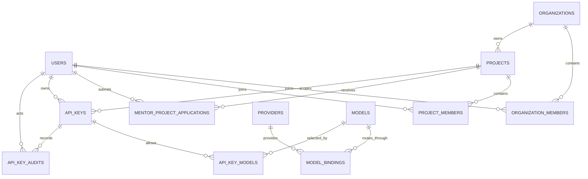

# Nebula 数据库设计

## 1. 文档范围

学生北辰逐笔回执通过迁移 0038 新增的 `gateway_calls (user_id, request_id)` 索引定位。查询同时核对调用用户和 API Key 所有者，在本人范围最多读取两个候选，同编号有歧义时返回 404。精确扣分来自 `gateway_calls.beichen_credit_exact`，上游实扣和应用标记取关联的 `beichen_call_receipts`。查询只读。

迁移 0039 在每笔北辰请求上保存发出时的学校系数、基础积分和计价依据，旧调用沿用原规则。上游流水保存原始实扣。学生月度额度和实际用量分别记录，教师直接分配的个人额度优先于后续 Key 审批的默认值。

迁移 0040 将官网的阶梯和缓存报价与对应的 Key、采样时间及报价版本关联。迁移 0041 记录学校管理的渠道、北辰使用明细和扫描位置。服务器重启后从已保存的位置继续，尚未能与学校请求匹配的明细也能独立留存。

教师逐笔对账按 `beichen_upstream_usage_rows.occurred_at` 选北京时间账日。供应商更正后的实扣来自这张归档表。与已入账调用的匹配复用按日汇总的条件，核对北辰回执、请求编号、渠道、模型、时间与冲突记录。学校积分取派发时确定的系数及原有入账金额，查询在只读事务内执行。网页读取进度只统计当前学校预配凭据版本的报价快照与逐笔分页检查点。

额度审批、项目/Key 调额与撤销必须同时锁定项目、Key 和当月 bucket；额度字段、bucket 与不可变审计在同一事务中提交。maintenance 使用会话级 advisory lock 单例执行，启动时及每小时预建 bucket，每分钟恢复 lease 过期超过 15 分钟的 pending 调用。

成员级免费模型调用不新增持久化表或重复计数列。查询项目用量时从 `monthly_usage_cube` 按 `(project_id, month, user_id, model_id)` 汇总 `zero_cost_count` 生成 `members[].free_models`，再由成员明细求和生成项目级 `free_models`，保证成员之和与项目总数一致。

本文档定义 Nebula 首期 PostgreSQL 持久化契约，与 `internal/infrastructure/db/ent/schema` 和控制面事务实现对应。仓库提供显式 `cmd/migrate` 初始化入口，服务启动不自动迁移；Docker 本地环境通过一次性 `migrate` service 执行同一入口，成功退出后 backend 才启动。项目不迁移参考项目历史数据。

设计依据来自参考项目真实 Alembic Migration、SQLAlchemy Model、Controller、Schema 与网关路由。新系统是 greenfield replatforming，不兼容旧表结构。

## 2. 全局约束

| 项目 | 约束 |
| --- | --- |
| 数据库 | PostgreSQL |
| ORM | Ent |
| 主键 | 应用侧生成 UUIDv7 |
| 表名 | snake_case，无 `nebula_` 前缀 |
| 时间 | `timestamptz`，应用和数据库统一使用 UTC |
| 大小写不敏感文本 | PostgreSQL `citext`；未来迁移必须先启用 `citext` extension |
| 删除策略 | 首期资源不提供删除 API；外键使用 `RESTRICT`，资源通过状态启用或停用 |
| 软删除 | 不使用 `deleted_at` |
| 凭据 | 用户密码仅保存强密码哈希；供应商凭据加密后保存；API Key 明文只在领取时返回一次 |

系统创建项目/Key 月度 credit bucket、调用日志、月度用量聚合、输入监控与治理审计表；余额、RPM、Token 限制、模型市场价格、通知和智能路由不在本期范围。验证码、refresh session、老师邀请和 SSE 事件存放在 Redis。

老师模型向导的默认基础配置和一键配置结果属于保存前的客户端状态，不新增草稿表。一键配置使用的手写 Key、供应商 `/v1/models` 响应和真实端点响应均不持久化；只有老师点击“保存基础配置”后，标准化字段才写入 `models`。Matrix 候选与供应商 Probe 共用同一套确定性映射：原始纯文本 `description` 直接作为模型说明，容量按结构化字段、description 明确值、模型族规则、全局默认的优先级得到；推导结果本身不新增持久化字段。

## 3. 枚举

| 枚举 | 值 |
| --- | --- |
| `user_role` | `student`, `mentor`, `teacher` |
| `user_status` | `pending_invite`, `active`, `disabled` |
| `resource_status` | `active`, `inactive` |
| `mentor_project_application_status` | `pending`, `approved`, `rejected`, `cancelled` |
| `model_category` | `text`, `image`, `audio`, `video`, `multimodal`, `embedding`, `rerank` |
| `model_status` | `pending_configuration`, `active`, `inactive` |
| `model_binding_adapter` | `openai_compatible`, `openai_responses`, `openai_embeddings`, `openai_images`, `openai_audio`, `openai_video`, `openai_realtime`, `openai_moderations`, `anthropic`, `cohere_rerank_v2`, `google_gemini_v1beta` |
| `api_key_status` | `pending_mentor`, `pending_teacher`, `approved`, `active`, `rejected`, `revoked` |
| `api_key_audit_action` | `mentor_approved`, `mentor_rejected`, `teacher_approved`, `teacher_rejected`, `mentor_revoked` |

## 4. 表结构

除特别说明外，所有 `id` 均为非空 UUIDv7 主键，`created_at` 和 `updated_at` 均为非空 `timestamptz`。

### 4.1 `users`

| 字段 | 类型 | 可空 | 默认值 | 约束与说明 |
| --- | --- | --- | --- | --- |
| `id` | uuid | 否 | UUIDv7 | 主键，不可变 |
| `name` | varchar(64) | 否 | - | 非空字符串 |
| `email` | citext | 否 | - | 最大 254 字符，全局唯一 |
| `password_hash` | varchar(255) | 否 | - | 密码哈希，敏感字段 |
| `role` | enum | 否 | - | `student/mentor/teacher`，创建后不可变 |
| `status` | enum | 否 | `active` | `pending_invite/active/disabled` |
| `created_at` | timestamptz | 否 | 当前时间 | 不可变 |
| `updated_at` | timestamptz | 否 | 当前时间 | 更新时刷新 |

索引：唯一索引 `email`；普通索引 `(role, status)`。

学生和导师可公开注册，创建后为 `active`。运行环境也可提供固定学生/导师测试账号，backend 启动时按规范化邮箱幂等创建 `active` 用户；若同邮箱用户已存在且角色一致则完全保留原记录，不同步姓名、密码或状态，角色冲突则拒绝启动。老师只能由首个老师初始化或老师邀请创建；邀请未激活时为 `pending_invite`。

### 4.2 `organizations`

| 字段 | 类型 | 可空 | 默认值 | 约束与说明 |
| --- | --- | --- | --- | --- |
| `id` | uuid | 否 | UUIDv7 | 主键 |
| `name` | citext | 否 | - | 最大 128 字符，全局唯一 |
| `description` | varchar(1024) | 是 | NULL | 组织说明 |
| `status` | enum | 否 | `active` | `active/inactive` |
| `created_at` | timestamptz | 否 | 当前时间 | 不可变 |
| `updated_at` | timestamptz | 否 | 当前时间 | 更新时刷新 |

索引：唯一索引 `name`；普通索引 `status`。不保存组织编码。

### 4.3 `organization_members`

| 字段 | 类型 | 可空 | 默认值 | 约束与说明 |
| --- | --- | --- | --- | --- |
| `id` | uuid | 否 | UUIDv7 | 主键 |
| `organization_id` | uuid | 否 | - | FK -> `organizations.id` |
| `user_id` | uuid | 否 | - | FK -> `users.id` |
| `created_at` | timestamptz | 否 | 当前时间 | 加入时间 |

索引：唯一索引 `(organization_id, user_id)`；普通索引 `user_id`。

该表只表示学生或导师当前属于某组织，不重复保存角色和状态。角色来自 `users.role`。老师拥有平台级权限，不写入此表。

### 4.4 `projects`

| 字段 | 类型 | 可空 | 默认值 | 约束与说明 |
| --- | --- | --- | --- | --- |
| `id` | uuid | 否 | UUIDv7 | 主键 |
| `organization_id` | uuid | 否 | - | FK -> `organizations.id`，不可变 |
| `name` | citext | 否 | - | 最大 128 字符，同组织内唯一 |
| `description` | varchar(1024) | 是 | NULL | 项目说明 |
| `status` | enum | 否 | `active` | `active/inactive` |
| `created_at` | timestamptz | 否 | 当前时间 | 不可变 |
| `updated_at` | timestamptz | 否 | 当前时间 | 更新时刷新 |

索引：唯一索引 `(organization_id, name)`；普通索引 `(organization_id, status)`。不保存项目编码、类型、owner 或预算。

### 4.5 `project_members`

| 字段 | 类型 | 可空 | 默认值 | 约束与说明 |
| --- | --- | --- | --- | --- |
| `id` | uuid | 否 | UUIDv7 | 主键 |
| `project_id` | uuid | 否 | - | FK -> `projects.id` |
| `user_id` | uuid | 否 | - | FK -> `users.id` |
| `created_at` | timestamptz | 否 | 当前时间 | 加入时间 |

索引：唯一索引 `(project_id, user_id)`；普通索引 `user_id`。

该表同时表达导师负责项目和学生加入项目。成员类型由 `users.role` 判定，不重复保存角色。

### 4.6 `mentor_project_applications`

| 字段 | 类型 | 可空 | 默认值 | 约束与说明 |
| --- | --- | --- | --- | --- |
| `id` | uuid | 否 | UUIDv7 | 主键 |
| `project_id` | uuid | 否 | - | FK -> `projects.id` |
| `mentor_id` | uuid | 否 | - | FK -> `users.id`，必须为导师 |
| `status` | enum | 否 | `pending` | `pending/approved/rejected/cancelled` |
| `reviewed_by` | uuid | 是 | NULL | FK -> `users.id`，审核老师 |
| `review_comment` | varchar(1000) | 是 | NULL | 审核意见；驳回时必填 |
| `reviewed_at` | timestamptz | 是 | NULL | 审核时间 |
| `created_at` | timestamptz | 否 | 当前时间 | 申请时间 |

索引：同一 `(project_id, mentor_id)` 最多一个 `pending` 申请的部分唯一索引；普通索引 `(status, created_at)`、`(mentor_id, created_at)`。

老师批准时，在同一事务中幂等创建导师的 `organization_members` 与 `project_members`。驳回或取消后，导师可以新建申请，历史申请不得改写或删除。

### 4.7 `providers`

| 字段 | 类型 | 可空 | 默认值 | 约束与说明 |
| --- | --- | --- | --- | --- |
| `id` | uuid | 否 | UUIDv7 | 主键 |
| `name` | citext | 否 | - | 最大 128 字符，全局唯一 |
| `base_url` | varchar(2048) | 否 | - | 上游基础 URL |
| `status` | enum | 否 | `active` | `active/inactive` |
| `created_at` | timestamptz | 否 | 当前时间 | 不可变 |
| `updated_at` | timestamptz | 否 | 当前时间 | 更新时刷新 |

索引：唯一索引 `name`；普通索引 `status`。不保存接口类型、超时、自定义 Header JSON。

迁移 0008 已将加密凭据移至 `provider_credentials`，一条供应商记录可以暂时没有凭据。迁移 0037 仅在缺少控制台能识别的北辰记录时，插入名称为「北辰」、地址为 `https://api.beichenapi.com` 的启用行。同名已被占用时给新行加数字后缀。已有北辰按地址识别并保留其名称、状态、凭据与绑定。该迁移不创建凭据、模型、绑定或账单。

学校维护 HTTPS 的服务器证书和私钥存于学校 Docker 的 `maintenance-tls` 命名卷，私钥目录仅由运行后端的用户读写。它们不存入业务数据库，供应商凭据仍使用原有加密存储。

0.13.0 的 HTTPS 控制台复用现有服务器证书、用户和供应商凭据记录。学校前端静态文件服务不访问证书卷或业务数据库。

0.11.0 的证书通知只读查找现有激活用户；绑定邮箱仍取自 `users.email`。Redis 以到期键记录一次通知申请，24 小时内抑制重复发送。此功能不更改账号、凭据、证书或学生用量。

### 4.8 `models`

| 字段 | 类型 | 可空 | 默认值 | 约束与说明 |
| --- | --- | --- | --- | --- |
| `id` | uuid | 否 | UUIDv7 | 内部主键 |
| `model_id` | citext | 否 | - | 最大 256 字符，对外模型 ID，全局唯一 |
| `display_name` | varchar(256) | 否 | - | 展示名 |
| `description` | varchar(2048) | 是 | NULL | 模型说明 |
| `category` | enum | 否 | `text` | 模型类别 |
| `capabilities` | jsonb string[] | 否 | `[]` | 能力标识集合 |
| `input_modalities` | jsonb string[] | 否 | `[]` | 输入模态集合 |
| `output_modalities` | jsonb string[] | 否 | `[]` | 输出模态集合 |
| `context_window` | integer | 是 | NULL | 正整数 |
| `max_input_tokens` | integer | 是 | NULL | 正整数；模型容量，不参与计费 |
| `max_output_tokens` | integer | 是 | NULL | 正整数 |
| `is_common` | boolean | 否 | false | 是否属于全局常用模型 |
| `status` | enum | 否 | `pending_configuration` | `pending_configuration/active/inactive` |
| `created_at` | timestamptz | 否 | 当前时间 | 不可变 |
| `updated_at` | timestamptz | 否 | 当前时间 | 更新时刷新 |

索引：唯一索引 `model_id`；普通索引 `(status, is_common)`、`(category, status)`。

学生提交申请时只提供 `model_id` 和可选 `display_name`。系统按 `model_id` 大小写不敏感去重；不存在时以名称默认等于 ID 的 `pending_configuration` 模型创建，已存在时忽略申请名称并复用平台权威配置。`capabilities` 只允许固定枚举，v0.8 迁移将历史自由文本能力全部清空。

### 4.8.1 `matrix_model_catalog`

Matrix 候选目录以 `model_id citext UNIQUE` 保存合并后的描述、owner、模型类型、端点类型、标签、原始条目数组、状态、最后出现时间和同步时间。同 ID 多条源记录合并为一行；集合取并集，描述选择最长非空纯文本，原始条目保留。成功快照中消失的记录标为 `inactive`，失败快照不改变上次成功数据。该表不直接关联学生白名单或平台 `models`。

### 4.9 `model_bindings`

| 字段 | 类型 | 可空 | 默认值 | 约束与说明 |
| --- | --- | --- | --- | --- |
| `id` | uuid | 否 | UUIDv7 | 主键 |
| `model_id` | uuid | 否 | - | FK -> `models.id` |
| `provider_id` | uuid | 否 | - | FK -> `providers.id` |
| `upstream_model_name` | varchar(256) | 否 | - | 供应商实际模型名 |
| `adapter` | enum | 否 | - | `openai_compatible/openai_responses/openai_embeddings/openai_images/openai_audio/openai_video/openai_realtime/openai_moderations/anthropic/cohere_rerank_v2/google_gemini_v1beta` |
| `priority` | integer | 否 | 100 | 非负；数值越小优先级越高 |
| `status` | enum | 否 | `active` | `active/inactive` |
| `created_at` | timestamptz | 否 | 当前时间 | 不可变 |
| `updated_at` | timestamptz | 否 | 当前时间 | 更新时刷新 |

索引：唯一索引 `(model_id, provider_id, adapter)`；普通索引 `(model_id, status, priority)`、`(provider_id, status)`。

一个模型可绑定多个供应商，也可在同一供应商下按协议分别建立 Binding。Chat/Completions、Responses、Embeddings、Images、Audio、Videos、Realtime、Moderations、Anthropic Messages、Cohere Rerank v2 与 Google Gemini `v1beta` 都使用独立 adapter。网关只选择与入口协议匹配且模型、binding 和 provider 均为 `active` 的候选，按 `priority ASC, id ASC` 稳定排序。

### 4.10 `api_keys`

| 字段 | 类型 | 可空 | 默认值 | 约束与说明 |
| --- | --- | --- | --- | --- |
| `id` | uuid | 否 | UUIDv7 | 申请与密钥的统一主键 |
| `owner_user_id` | uuid | 否 | - | FK -> `users.id`，必须为学生 |
| `project_id` | uuid | 否 | - | FK -> `projects.id`；组织由项目唯一确定 |
| `name` | citext | 否 | - | 最大 128 字符 |
| `status` | enum | 否 | `pending_mentor` | Key 生命周期状态 |
| `key_hash` | bytea | 是 | NULL | 领取后写入的带 pepper HMAC/hash，全局唯一、不可变 |
| `key_prefix` | varchar(32) | 是 | NULL | 领取后写入的可展示前缀，不可变 |
| `claimed_at` | timestamptz | 是 | NULL | 首次领取时间，不可变 |
| `revoked_at` | timestamptz | 是 | NULL | 撤销时间，不可变 |
| `created_at` | timestamptz | 否 | 当前时间 | 申请时间 |
| `updated_at` | timestamptz | 否 | 当前时间 | 状态变化时刷新 |

索引：`key_hash` 非 NULL 时全局唯一；同一学生 `(owner_user_id, name)` 在 `pending_mentor/pending_teacher/approved/active` 状态下大小写不敏感唯一；普通索引 `(owner_user_id, created_at)`、`(project_id, status, created_at)`、`(status, created_at)`。

不单独保存 `organization_id`，避免与 `projects.organization_id` 产生双重事实。`rejected/revoked` 后允许复用名称。

### 4.11 `api_key_models`

| 字段 | 类型 | 可空 | 默认值 | 约束与说明 |
| --- | --- | --- | --- | --- |
| `id` | uuid | 否 | UUIDv7 | 主键 |
| `api_key_id` | uuid | 否 | - | FK -> `api_keys.id` |
| `model_id` | uuid | 否 | - | FK -> `models.id` |
| `created_at` | timestamptz | 否 | 当前时间 | 关联创建时间 |

索引：唯一索引 `(api_key_id, model_id)`；普通索引 `model_id`。该规范化关联替代旧 JSON 模型白名单。

### 4.12 `api_key_audits`

| 字段 | 类型 | 可空 | 默认值 | 约束与说明 |
| --- | --- | --- | --- | --- |
| `id` | uuid | 否 | UUIDv7 | 主键 |
| `api_key_id` | uuid | 否 | - | FK -> `api_keys.id` |
| `actor_user_id` | uuid | 否 | - | FK -> `users.id`，执行审核或撤销的用户 |
| `action` | enum | 否 | - | Key 审核动作，不可变 |
| `comment` | varchar(1000) | 是 | NULL | 通过时可选；驳回和撤销时必填非空文本 |
| `created_at` | timestamptz | 否 | 当前时间 | 动作发生时间，不可变 |

索引：普通索引 `(api_key_id, created_at)`、`(actor_user_id, created_at)`。

审计记录只允许插入，不允许更新或删除。数据库 `CHECK` 保证 `mentor_rejected/teacher_rejected/mentor_revoked` 的 `comment` 非空；角色与状态迁移由事务服务校验。

## 5. 关系图



## 6. 状态机与事务规则

### 6.1 API Key 状态机

```text
pending_mentor --导师通过--> pending_teacher --老师通过--> approved --学生领取--> active
pending_mentor --导师驳回--> rejected
pending_teacher --老师驳回--> rejected
active --负责导师撤销--> revoked
```

- 学生只能从属于目标项目组织的 `active` 导师中获得初审；具体实现允许项目任一负责导师抢占首个有效初审。
- 初审必须以条件更新保证只有一次 `pending_mentor -> pending_teacher/rejected` 成功，随后追加一条审计记录。
- 老师终审前，申请关联的所有模型必须为 `active`，且每个模型至少有一个 `active` binding，其 provider 也必须为 `active`。
- 老师通过时，在同一数据库事务中：锁定申请、校验状态与模型、幂等创建学生组织成员关系、幂等创建学生项目成员关系、追加审计、更新为 `approved`。
- 学生成员关系在 Key 被撤销后仍保留。
- 学生领取时，在同一事务中以条件更新保证只领取一次：生成高熵 secret，计算配置 pepper 下的 HMAC/hash，写入 `key_hash/key_prefix/claimed_at`，状态改为 `active`。事务提交后只在本次响应返回明文。
- 撤销使用条件更新保证只有 `active -> revoked` 成功，同时写入 `revoked_at` 和不可变审计。

### 6.2 导师项目申请

- 申请人必须是 `active` 导师，且已属于目标项目的组织；项目和组织必须为 `active`。
- 同一导师对同一项目最多存在一个 `pending` 申请。
- 老师批准时幂等创建 `project_members`；拒绝时必须填写原因；终态申请保留历史。

### 6.3 一致性边界

以下规则不由单个外键表达，必须由应用事务和授权层强制：用户角色与成员表类型匹配、项目组织归属、审核人角色、导师是否负责目标项目、合法状态迁移、模型终审条件、Key 领取的一次性返回。

模型路由一致性检查不改变 Schema，也不执行迁移。将模型设为 ACTIVE、停用 provider 或停用 binding 时，应用在同一事务中锁定受影响模型和路由记录；任何 ACTIVE 模型必须始终保留至少一个 ACTIVE binding 且对应 provider 为 ACTIVE。已有不一致数据不会自动修复，由老师在模型管理中手动配置或停用模型。

## 7. Redis 外部状态

| Key/Stream 逻辑 | 内容 | 生命周期 |
| --- | --- | --- |
| 邮箱验证码 | code hash、用途、失败次数、锁定状态 | 验证码 TTL/冷却/锁定配置 |
| Refresh session | session ID、user ID、token hash、family ID | refresh TTL；轮换后旧 token 失效 |
| 老师邀请 | invitation token hash、邀请邮箱、邀请人 | invitation TTL；激活后删除 |
| 用户 SSE stream | Key 状态事件 | 有界 Redis Stream |
| 全局模型 SSE stream | 常用模型变更事件 | 有界 Redis Stream |
| 网关资源路由 | 上游资源类型与 ID 对应的 model binding ID；当前用于异步 video 查询、内容下载和 remix | `GATEWAY_RESOURCE_ROUTE_TTL_HOURS` |

Redis 不是业务权威数据源。客户端 SSE 断线重连后必须重新调用 REST API 获取权威状态。

## 8. Docker 本地持久化

- PostgreSQL 数据保存在命名卷 `nebula-api_postgres-data`，Redis AOF 保存在 `nebula-api_redis-data`。
- `scripts/compose.ps1` 从 Doppler `nebula-api/dev_personal` 中的本地 `DATABASE_URL` 派生 PostgreSQL 初始化账号、密码和数据库名，并把容器内 DSN host 改为 Compose service `postgres`；不落盘真实值。
- 生产部署由 `/opt/nebula-api/scripts/fetch-production-configuration.sh` 直连 Doppler `nebula-api/prd`，使用按名 REST 查询注入独立的 `DATABASE_URL`，只接受 loopback 或 Compose `postgres` host，改写为容器 DNS 后在服务器本机构建版本化应用镜像并显式执行一次性 `migrate` service；backend 仍不得隐式迁移。cloudflared 只加入 `edge` 网络，不加入内部 `data` 网络，因此 Tunnel 不改变数据库网络边界。
- 生产 PostgreSQL 使用 `deploy/docker-default-seccomp-v26.1.4-enosys.json`。该文件保持 Docker 26.1.4 默认允许列表，仅将默认拒绝 errno 设为 `ENOSYS`，用于兼容旧宿主机 libseccomp 无法识别新 syscall 的场景；不得替换为 `seccomp=unconfined`。
- 生产 PostgreSQL 同时加入内部 `data` 网络和仅该服务使用的 `management` 网络，并映射到服务器本机 `127.0.0.1:15432`，仅用于通过 SSH tunnel 的受控管理访问；公网不开放 5432，应用仍通过 Compose 内部 `postgres:5432` 连接。
- `migrate` service 在 PostgreSQL 健康后执行 `CREATE EXTENSION IF NOT EXISTS citext` 和 Ent schema create；它不负责历史数据迁移或回滚。
- 普通 `docker compose down` 不删除命名卷；`down -v` 会永久删除本地数据库和 Redis 数据，属于需明确授权的破坏性操作。

## 9. 用量与监控表

`project_month_credit_buckets` 与 `api_key_month_credit_buckets` 按北京时间月份保存额度、分配、charged 和 pending；`monthly_usage_cube` 永久保存项目、用户、Key、模型维度聚合。`gateway_calls`/`gateway_call_attempts` 保存 365 天原始调用与供应商尝试，`monitored_inputs` 保存 90 天完整文本。访问审计、额度调整审计和倍率调整审计永久保留；模型倍率从 NULL 首次设置时不产生倍率调整审计，后续改为不同值时必须记录原因。

迁移 0029 增加单次调用的上游凭据、绑定和模型标识，以及缓存读、缓存未命中、缓存写和推理用量。可空列区分显式 0 和缺项。用量状态 `reported`、`missing`、`interrupted` 分别表示已报告、未取到和传输中断。上游 `credit` 的缩放值仅表示供应商原始额度数值，不作为美元成本参与对账。

迁移 0030 增加北辰同步状态、不可变的上游报价和倍率版本、校内手动价版本以及按凭据、模型和北京时间日期保存的北辰账单。试算按调用时刻选择对应的有效版本，日汇总按明示的缓存口径计算；数据缺失的比较项保持为空。同步任务的租约防止多实例重复拉取。

迁移 0031 在已有北辰账单上增加逐笔明细来源 `export`。凭据标签与有无已确认日账的检测在同一个凭据锁事务内执行。入库只保存按日、凭据和模型汇总的用量、实付金额及操作人。自动确认整日时清理同日旧的 `usage` 和 `export` 记录，手工汇总 `csv` 优先保留。

迁移 0032 在 `gateway_calls` 记录北辰发件凭据、上游模型、发件时间、报价版本、倍率版本、核账原因和精确积分 `beichen_credit_exact`。状态 `beichen_state` 分为已预留 `reserved`、待核账 `pending_review`、已扣 `charged` 和已释放 `released`。只有已扣行有精确积分，待核账行的精确积分为空。最终结算锁定调用行，在同一事务释放预留并更新项目、成员、Key 月桶、用量汇总和对话轮次。已结算回执可安全重放。月桶、汇总和轮次中的 `charged_milli_remainder` 保存不足千分之一积分的余数，以 PostgreSQL `numeric` 精确累计。北辰待核和已扣记录保留供查账。用量在返回后确定，一次高用量调用的最终费用可能超出发出时的剩余额度。

迁移 0033 为报价增加 `panel` 来源，新增 `beichen_panel_snapshots` 保存凭据版本、分组、有效期和同次采集的倍率版本。按发送时点和实际渠道查价，基础价应用一次倍率，最终价直接使用。采价过期、被撤销、模型被移除或遇到不支持的计价方式时，对应面板报价失效。迁移 0034 的 `beichen_panel_access` 按凭据保存北辰分组、加密面板令牌、修改人和修改时间。停用行覆盖部署默认值。个人扣费只采用能够归属于该次调用的完整明细，共享渠道的日账用于对账。

老师终审必须在同一事务内锁定项目、待审 Key、相关模型与当月项目 bucket；更新 `project_month_credit_buckets.allocated_milli` 时，条件必须同时包含 `project_id` 和当前上海月份。任何 SQL 绑定、约束或提交错误都必须回滚 Key 状态、项目分配、Key bucket、成员关系和审核记录，不允许部分成功。

迁移 0035 为北辰 HTTP 请求固定发件时的北辰 Key 数字编号与授权版本。网关收到北辰的 `X-Client-Request-ID` 后记录其 UUID。`beichen_receipt_response_claims` 记录编号的占用和冲突。`beichen_call_receipts` 保存精确匹配的上游流水行号、请求编号、模型、北辰实付金额、普通输入、输出和缓存读写，独立保留网关原始回包。补记、更新月桶和保存流水在一个事务内完成；流水号、请求编号和本地调用分别唯一。一个实际余额单位乘 100，流水金额已含北辰倍率。

北辰报价快照的 `model_pricing` 按本次采样的 Key 模型 ID 保存官网标准价对象。同一次采样中，模型已在 Key 目录内、对应分组有模型表且其中没有这个名称时，保存 JSON 空值。键缺失表示当次没有对它得出结论，旧快照及刚进入目录的模型沿用该含义。只有存在价格依据的快照才计入有效报价渠道数。

## 10. 相比参考项目删除的结构

- 用户：删除第三方 SSO、权限位掩码、额度、余额、计费和软删除字段。
- 组织：删除 `code`，名称作为唯一的人类可读标识。
- 项目：删除 code、type、owner、预算及用量字段。
- 供应商：删除接口类型、超时、自定义 Header JSON；协议适配下沉到模型 binding。
- 模型：删除市场价格、智能路由和计费字段。
- API Key：删除 JSON allowlist、RPM、Token 限制；模型白名单规范化为关联表，新增月度 credit 额度。
- 全部删除：余额 billing、RPM/Token 限制、notification、soft-delete、internal usage/monitor 路由相关旧结构；新的 credit usage 表见上一节。

官方控制台的工作区路由名称仅用于前端导航，并与中文页面标题分离；该路由契约不增加数据库表、字段、索引、枚举或迁移。

官方控制台的页面动效、加载骨架、网络活动计数、提交中状态和启动时的 bootstrap single-flight 全部为浏览器内存 UI 状态，不写入 PostgreSQL 或 Redis；本功能不增加表、字段、索引、枚举、关系、事务或迁移。
