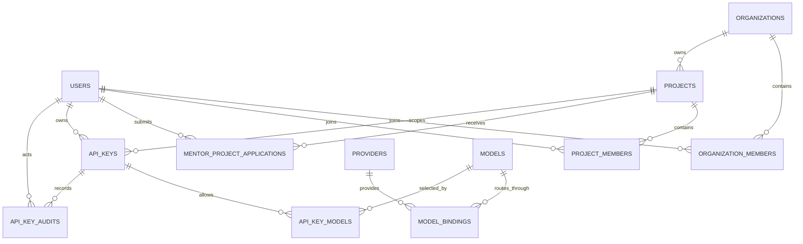

# Nebula 数据库设计

## 1. 文档范围

迁移按文件名顺序登记在 `schema_migrations`。0.28.6 基线的文件编号在 `0035` 和 `0037` 之间有历史空档。0.29.0 在 `0071` 后新增 `0072_beichen_channel_identity.sql`。

学生北辰逐笔回执通过迁移 0038 新增的 `gateway_calls (user_id, request_id)` 索引定位。查询同时核对调用用户和 API Key 所有者，在本人范围最多读取两个候选，同编号有歧义时返回 404。精确扣分来自 `gateway_calls.beichen_credit_exact`，上游实扣和应用标记取关联的 `beichen_call_receipts`。查询只读。

迁移 0039 在每笔北辰请求上保存发出时的学校系数、基础积分和计价依据，旧调用沿用原规则。上游流水保存原始实扣。学生月度额度和实际用量分别记录，教师直接分配的个人额度优先于后续 Key 审批的默认值。

迁移 0040 将官网的阶梯和缓存报价与对应的 Key、采样时间及报价版本关联。迁移 0041 记录学校管理的渠道、北辰使用明细和扫描位置。服务器重启后从已保存的位置继续，尚未能与学校请求匹配的明细也能独立留存。

教师逐笔对账按 `beichen_upstream_usage_rows.occurred_at` 选北京时间账日。供应商更正后的实扣来自这张归档表。与已入账调用的匹配复用按日汇总的条件，核对北辰回执、请求编号、渠道、模型、时间与冲突记录。学校积分取派发时确定的系数及原有入账金额，查询在只读事务内执行。网页报价进度使用当前渠道 Key 的有效快照，流水进度使用当前授权版本的分页检查点。

额度审批、项目/Key 调额与撤销必须同时锁定项目、Key 和当月 bucket；额度字段、bucket 与不可变审计在同一事务中提交。maintenance 使用会话级 advisory lock 单例执行，启动时及每小时预建 bucket，每分钟恢复 lease 过期超过 15 分钟的 pending 调用。

成员级免费模型调用不新增持久化表或重复计数列。查询项目用量时从 `monthly_usage_cube` 按 `(project_id, month, user_id, model_id)` 汇总 `zero_cost_count` 生成 `members[].free_models`，再由成员明细求和生成项目级 `free_models`，保证成员之和与项目总数一致。

本文档定义 Nebula 首期 PostgreSQL 持久化契约，与 `internal/infrastructure/db/ent/schema` 和控制面事务实现对应。仓库提供显式 `cmd/migrate` 初始化入口，服务启动不自动迁移；Docker 本地环境通过一次性 `migrate` service 执行同一入口，成功退出后 backend 才启动。项目不迁移参考项目历史数据。

设计依据来自参考项目真实 Alembic Migration、SQLAlchemy Model、Controller、Schema 与网关路由。新系统是 greenfield replatforming，不兼容旧表结构。

## 2. 全局约束

| 项目 | 约束 |
| --- | --- |
| 数据库 | PostgreSQL |
| ORM | Ent |
| 主键 | 应用侧生成 UUIDv7 |
| 表名 | snake_case，无 `nebula_` 前缀 |
| 时间 | `timestamptz`，应用和数据库统一使用 UTC |
| 大小写不敏感文本 | PostgreSQL `citext`；未来迁移必须先启用 `citext` extension |
| 删除策略 | 首期资源不提供删除 API；外键使用 `RESTRICT`，资源通过状态启用或停用 |
| 软删除 | 不使用 `deleted_at` |
| 凭据 | 用户密码仅保存强密码哈希；供应商凭据加密后保存；API Key 明文只在领取时返回一次 |

系统创建项目/Key 月度 credit bucket、调用日志、月度用量聚合、输入监控与治理审计表；余额、RPM、Token 限制、模型市场价格、通知和智能路由不在本期范围。验证码、refresh session、老师邀请和 SSE 事件存放在 Redis。

老师模型向导的默认基础配置和一键配置结果属于保存前的客户端状态，不新增草稿表。一键配置使用的手写 Key、供应商 `/v1/models` 响应和真实端点响应均不持久化；只有老师点击“保存基础配置”后，标准化字段才写入 `models`。Matrix 候选与供应商 Probe 共用同一套确定性映射：原始纯文本 `description` 直接作为模型说明，容量按结构化字段、description 明确值、模型族规则、全局默认的优先级得到；推导结果本身不新增持久化字段。

## 3. 枚举

| 枚举 | 值 |
| --- | --- |
| `user_role` | `student`, `mentor`, `teacher` |
| `user_status` | `pending_invite`, `active`, `disabled` |
| `resource_status` | `active`, `inactive` |
| `mentor_project_application_status` | `pending`, `approved`, `rejected`, `cancelled` |
| `model_category` | `text`, `image`, `audio`, `video`, `multimodal`, `embedding`, `rerank` |
| `model_status` | `pending_configuration`, `active`, `inactive` |
| `model_binding_adapter` | `openai_compatible`, `openai_responses`, `openai_embeddings`, `openai_images`, `openai_audio`, `openai_video`, `openai_realtime`, `openai_moderations`, `anthropic`, `cohere_rerank_v2`, `google_gemini_v1beta` |
| `api_key_status` | `pending_mentor`, `pending_teacher`, `approved`, `active`, `rejected`, `revoked` |
| `api_key_audit_action` | `mentor_approved`, `mentor_rejected`, `teacher_approved`, `teacher_rejected`, `mentor_revoked` |

## 4. 表结构

除特别说明外，所有 `id` 均为非空 UUIDv7 主键，`created_at` 和 `updated_at` 均为非空 `timestamptz`。

### 4.1 `users`

| 字段 | 类型 | 可空 | 默认值 | 约束与说明 |
| --- | --- | --- | --- | --- |
| `id` | uuid | 否 | UUIDv7 | 主键，不可变 |
| `name` | varchar(64) | 否 | - | 非空字符串 |
| `email` | citext | 否 | - | 最大 254 字符，全局唯一 |
| `password_hash` | varchar(255) | 否 | - | 密码哈希，敏感字段 |
| `role` | enum | 否 | - | `student/mentor/teacher`，创建后不可变 |
| `status` | enum | 否 | `active` | `pending_invite/active/disabled` |
| `created_at` | timestamptz | 否 | 当前时间 | 不可变 |
| `updated_at` | timestamptz | 否 | 当前时间 | 更新时刷新 |

索引：唯一索引 `email`；普通索引 `(role, status)`。

学生和导师可公开注册，创建后为 `active`。运行环境也可提供固定学生/导师测试账号，backend 启动时按规范化邮箱幂等创建 `active` 用户；若同邮箱用户已存在且角色一致则完全保留原记录，不同步姓名、密码或状态，角色冲突则拒绝启动。老师只能由首个老师初始化或老师邀请创建；邀请未激活时为 `pending_invite`。

### 4.2 `organizations`

| 字段 | 类型 | 可空 | 默认值 | 约束与说明 |
| --- | --- | --- | --- | --- |
| `id` | uuid | 否 | UUIDv7 | 主键 |
| `name` | citext | 否 | - | 最大 128 字符，全局唯一 |
| `description` | varchar(1024) | 是 | NULL | 组织说明 |
| `status` | enum | 否 | `active` | `active/inactive` |
| `created_at` | timestamptz | 否 | 当前时间 | 不可变 |
| `updated_at` | timestamptz | 否 | 当前时间 | 更新时刷新 |

索引：唯一索引 `name`；普通索引 `status`。不保存组织编码。

### 4.3 `organization_members`

| 字段 | 类型 | 可空 | 默认值 | 约束与说明 |
| --- | --- | --- | --- | --- |
| `id` | uuid | 否 | UUIDv7 | 主键 |
| `organization_id` | uuid | 否 | - | FK -> `organizations.id` |
| `user_id` | uuid | 否 | - | FK -> `users.id` |
| `created_at` | timestamptz | 否 | 当前时间 | 加入时间 |

索引：唯一索引 `(organization_id, user_id)`；普通索引 `user_id`。

该表只表示学生或导师当前属于某组织，不重复保存角色和状态。角色来自 `users.role`。老师拥有平台级权限，不写入此表。

### 4.4 `projects`

| 字段 | 类型 | 可空 | 默认值 | 约束与说明 |
| --- | --- | --- | --- | --- |
| `id` | uuid | 否 | UUIDv7 | 主键 |
| `organization_id` | uuid | 否 | - | FK -> `organizations.id`，不可变 |
| `name` | citext | 否 | - | 最大 128 字符，同组织内唯一 |
| `description` | varchar(1024) | 是 | NULL | 项目说明 |
| `status` | enum | 否 | `active` | `active/inactive` |
| `created_at` | timestamptz | 否 | 当前时间 | 不可变 |
| `updated_at` | timestamptz | 否 | 当前时间 | 更新时刷新 |

索引：唯一索引 `(organization_id, name)`；普通索引 `(organization_id, status)`。不保存项目编码、类型、owner 或预算。

### 4.5 `project_members`

| 字段 | 类型 | 可空 | 默认值 | 约束与说明 |
| --- | --- | --- | --- | --- |
| `id` | uuid | 否 | UUIDv7 | 主键 |
| `project_id` | uuid | 否 | - | FK -> `projects.id` |
| `user_id` | uuid | 否 | - | FK -> `users.id` |
| `created_at` | timestamptz | 否 | 当前时间 | 加入时间 |

索引：唯一索引 `(project_id, user_id)`；普通索引 `user_id`。

该表同时表达导师负责项目和学生加入项目。成员类型由 `users.role` 判定，不重复保存角色。

### 4.6 `mentor_project_applications`

| 字段 | 类型 | 可空 | 默认值 | 约束与说明 |
| --- | --- | --- | --- | --- |
| `id` | uuid | 否 | UUIDv7 | 主键 |
| `project_id` | uuid | 否 | - | FK -> `projects.id` |
| `mentor_id` | uuid | 否 | - | FK -> `users.id`，必须为导师 |
| `status` | enum | 否 | `pending` | `pending/approved/rejected/cancelled` |
| `reviewed_by` | uuid | 是 | NULL | FK -> `users.id`，审核老师 |
| `review_comment` | varchar(1000) | 是 | NULL | 审核意见；驳回时必填 |
| `reviewed_at` | timestamptz | 是 | NULL | 审核时间 |
| `created_at` | timestamptz | 否 | 当前时间 | 申请时间 |

索引：同一 `(project_id, mentor_id)` 最多一个 `pending` 申请的部分唯一索引；普通索引 `(status, created_at)`、`(mentor_id, created_at)`。

老师批准时，在同一事务中幂等创建导师的 `organization_members` 与 `project_members`。驳回或取消后，导师可以新建申请，历史申请不得改写或删除。

### 4.7 `providers`

| 字段 | 类型 | 可空 | 默认值 | 约束与说明 |
| --- | --- | --- | --- | --- |
| `id` | uuid | 否 | UUIDv7 | 主键 |
| `name` | citext | 否 | - | 最大 128 字符，全局唯一 |
| `base_url` | varchar(2048) | 否 | - | 上游基础 URL |
| `status` | enum | 否 | `active` | `active/inactive` |
| `created_at` | timestamptz | 否 | 当前时间 | 不可变 |
| `updated_at` | timestamptz | 否 | 当前时间 | 更新时刷新 |

索引：唯一索引 `name`；普通索引 `status`。不保存接口类型、超时、自定义 Header JSON。

迁移 0008 已将加密凭据移至 `provider_credentials`，一条供应商记录可以暂时没有凭据。迁移 0037 仅在缺少控制台能识别的北辰记录时，插入名称为「北辰」、地址为 `https://api.beichenapi.com` 的启用行。同名已被占用时给新行加数字后缀。已有北辰按地址识别并保留其名称、状态、凭据与绑定。该迁移不创建凭据、模型、绑定或账单。

迁移 `0067_beichen_credential_retired_at.sql` 为 `provider_credentials` 增加可空的 `retired_at timestamptz`。已有停用渠道用迁移时的 `updated_at` 回填。停用北辰渠道时记录时间，重新启用时清空，改名、分组和采价配置不会改写停用时间。`updated_at` 继续用于价格和回执版本。区间对账要求渠道同步至 `retired_at` 所在的北京时间账日，包含停用当天。

学校维护 HTTPS 的服务器证书和私钥存于学校 Docker 的 `maintenance-tls` 命名卷，私钥目录仅由运行后端的用户读写。它们不存入业务数据库，供应商凭据仍使用原有加密存储。

0.13.0 的 HTTPS 控制台复用现有服务器证书、用户和供应商凭据记录。学校前端静态文件服务不访问证书卷或业务数据库。

0.11.0 的证书通知只读查找现有激活用户；绑定邮箱仍取自 `users.email`。Redis 以到期键记录一次通知申请，24 小时内抑制重复发送。此功能不更改账号、凭据、证书或学生用量。

### 4.8 `models`

| 字段 | 类型 | 可空 | 默认值 | 约束与说明 |
| --- | --- | --- | --- | --- |
| `id` | uuid | 否 | UUIDv7 | 内部主键 |
| `model_id` | citext | 否 | - | 最大 256 字符，对外模型 ID，全局唯一 |
| `display_name` | varchar(256) | 否 | - | 展示名 |
| `description` | varchar(2048) | 是 | NULL | 模型说明 |
| `category` | enum | 否 | `text` | 模型类别 |
| `capabilities` | jsonb string[] | 否 | `[]` | 能力标识集合 |
| `input_modalities` | jsonb string[] | 否 | `[]` | 输入模态集合 |
| `output_modalities` | jsonb string[] | 否 | `[]` | 输出模态集合 |
| `context_window` | integer | 是 | NULL | 正整数 |
| `max_input_tokens` | integer | 是 | NULL | 正整数；模型容量，不参与计费 |
| `max_output_tokens` | integer | 是 | NULL | 正整数 |
| `is_common` | boolean | 否 | false | 是否属于全局常用模型 |
| `status` | enum | 否 | `pending_configuration` | `pending_configuration/active/inactive` |
| `created_at` | timestamptz | 否 | 当前时间 | 不可变 |
| `updated_at` | timestamptz | 否 | 当前时间 | 更新时刷新 |

索引：唯一索引 `model_id`；普通索引 `(status, is_common)`、`(category, status)`。

学生提交申请时只提供 `model_id` 和可选 `display_name`。系统按 `model_id` 大小写不敏感去重；不存在时以名称默认等于 ID 的 `pending_configuration` 模型创建，已存在时忽略申请名称并复用平台权威配置。`capabilities` 只允许固定枚举，v0.8 迁移将历史自由文本能力全部清空。

### 4.8.1 `matrix_model_catalog`

Matrix 候选目录以 `model_id citext UNIQUE` 保存合并后的描述、owner、模型类型、端点类型、标签、原始条目数组、状态、最后出现时间和同步时间。同 ID 多条源记录合并为一行；集合取并集，描述选择最长非空纯文本，原始条目保留。成功快照中消失的记录标为 `inactive`，失败快照不改变上次成功数据。该表不直接关联学生白名单或平台 `models`。

### 4.9 `model_bindings`

| 字段 | 类型 | 可空 | 默认值 | 约束与说明 |
| --- | --- | --- | --- | --- |
| `id` | uuid | 否 | UUIDv7 | 主键 |
| `model_id` | uuid | 否 | - | FK -> `models.id` |
| `provider_id` | uuid | 否 | - | FK -> `providers.id` |
| `upstream_model_name` | varchar(256) | 否 | - | 供应商实际模型名 |
| `adapter` | enum | 否 | - | `openai_compatible/openai_responses/openai_embeddings/openai_images/openai_audio/openai_video/openai_realtime/openai_moderations/anthropic/cohere_rerank_v2/google_gemini_v1beta` |
| `priority` | integer | 否 | 100 | 非负；数值越小优先级越高 |
| `status` | enum | 否 | `active` | `active/inactive` |
| `created_at` | timestamptz | 否 | 当前时间 | 不可变 |
| `updated_at` | timestamptz | 否 | 当前时间 | 更新时刷新 |

索引：唯一索引 `(model_id, provider_id, adapter)`；普通索引 `(model_id, status, priority)`、`(provider_id, status)`。

一个模型可绑定多个供应商，也可在同一供应商下按协议分别建立 Binding。Chat/Completions、Responses、Embeddings、Images、Audio、Videos、Realtime、Moderations、Anthropic Messages、Cohere Rerank v2 与 Google Gemini `v1beta` 都使用独立 adapter。网关只选择与入口协议匹配且模型、binding 和 provider 均为 `active` 的候选，按 `priority ASC, id ASC` 稳定排序。

### 4.10 `api_keys`

| 字段 | 类型 | 可空 | 默认值 | 约束与说明 |
| --- | --- | --- | --- | --- |
| `id` | uuid | 否 | UUIDv7 | 申请与密钥的统一主键 |
| `owner_user_id` | uuid | 否 | - | FK -> `users.id`，必须为学生 |
| `project_id` | uuid | 否 | - | FK -> `projects.id`；组织由项目唯一确定 |
| `name` | citext | 否 | - | 最大 128 字符 |
| `status` | enum | 否 | `pending_mentor` | Key 生命周期状态 |
| `key_hash` | bytea | 是 | NULL | 领取后写入的带 pepper HMAC/hash，全局唯一、不可变 |
| `key_prefix` | varchar(32) | 是 | NULL | 领取后写入的可展示前缀，不可变 |
| `claimed_at` | timestamptz | 是 | NULL | 首次领取时间，不可变 |
| `revoked_at` | timestamptz | 是 | NULL | 撤销时间，不可变 |
| `created_at` | timestamptz | 否 | 当前时间 | 申请时间 |
| `updated_at` | timestamptz | 否 | 当前时间 | 状态变化时刷新 |

索引：`key_hash` 非 NULL 时全局唯一；同一学生 `(owner_user_id, name)` 在 `pending_mentor/pending_teacher/approved/active` 状态下大小写不敏感唯一；普通索引 `(owner_user_id, created_at)`、`(project_id, status, created_at)`、`(status, created_at)`。

不单独保存 `organization_id`，避免与 `projects.organization_id` 产生双重事实。`rejected/revoked` 后允许复用名称。

### 4.11 `api_key_models`

| 字段 | 类型 | 可空 | 默认值 | 约束与说明 |
| --- | --- | --- | --- | --- |
| `id` | uuid | 否 | UUIDv7 | 主键 |
| `api_key_id` | uuid | 否 | - | FK -> `api_keys.id` |
| `model_id` | uuid | 否 | - | FK -> `models.id` |
| `created_at` | timestamptz | 否 | 当前时间 | 关联创建时间 |

索引：唯一索引 `(api_key_id, model_id)`；普通索引 `model_id`。该规范化关联替代旧 JSON 模型白名单。

Key 申请和审批可在没有任何授权关联时完成。学生扩充授权时，事务锁定本人 Key 行，校验 Key 和项目访问状态、模型报价及发布线路。待验证线路可授权，维护中的模型暂停新增。学生移除授权时同样锁定本人 Key。每批新增或删除的关联和审计一起提交，同一 Key 的并发写入依次处理。个人模型库用于收藏。网关按请求直接读取授权关系。

### 4.12 `api_key_audits`

| 字段 | 类型 | 可空 | 默认值 | 约束与说明 |
| --- | --- | --- | --- | --- |
| `id` | uuid | 否 | UUIDv7 | 主键 |
| `api_key_id` | uuid | 否 | - | FK -> `api_keys.id` |
| `actor_user_id` | uuid | 否 | - | FK -> `users.id`，执行该操作的用户 |
| `action` | enum | 否 | - | Key 审核或授权动作，不可变 |
| `comment` | varchar(1000) | 是 | NULL | 审核通过时可选，指定的驳回或撤销操作需提供原因。增删模型授权时记录公开模型 ID |
| `created_at` | timestamptz | 否 | 当前时间 | 动作发生时间，不可变 |

索引：普通索引 `(api_key_id, created_at)`、`(actor_user_id, created_at)`。

审计记录只允许插入，不允许更新或删除。数据库 `CHECK` 保证 `mentor_rejected/teacher_rejected/mentor_revoked` 的 `comment` 非空；角色与状态迁移由事务服务校验。

迁移 `0047_student_key_model_audit.sql` 增加 `student_model_added`。迁移 `0060_student_key_model_removal.sql` 扩展约束以允许 `student_model_removed`，保留历史审计和模型授权。两种动作均要求 `comment` 包含公开模型 ID。每个实际变更写一条记录，重复提交没有变更时也没有新增审计。

## 5. 关系图



## 6. 状态机与事务规则

### 6.1 API Key 状态机

```text
pending_mentor --负责导师批准--> approved --学生领取--> active
pending_mentor --导师驳回--> rejected
active --负责导师停用--> inactive --负责导师恢复--> active
```

- 项目的负责导师只能对 `pending_mentor` 申请做出一次有效决定。通过与驳回均以条件更新保证单次状态变化，并写审核记录。
- 批准事务校验组织、项目、申请状态及月额度，建立学生组织和项目成员关系，写审核审计并更新为 `approved`。允许零模型申请通过。
- 学生成员关系在 Key 被撤销后仍保留。
- 学生领取时，在同一事务中以条件更新保证只领取一次：生成高熵 secret，计算配置 pepper 下的 HMAC/hash，写入 `key_hash/key_prefix/claimed_at`，状态改为 `active`。事务提交后只在本次响应返回明文。
- 撤销使用条件更新保证只有 `active -> revoked` 成功，同时写入 `revoked_at` 和不可变审计。

### 6.2 导师项目申请

- 申请人必须是 `active` 导师，且已属于目标项目的组织；项目和组织必须为 `active`。
- 同一导师对同一项目最多存在一个 `pending` 申请。
- 老师批准时幂等创建 `project_members`；拒绝时必须填写原因；终态申请保留历史。

### 6.3 一致性边界

应用事务和授权层负责校验用户角色、成员类型、项目归属、导师负责范围、Key 状态迁移和领取条件。

模型路由一致性检查不改变 Schema，也不执行迁移。将模型设为 ACTIVE、停用 provider 或停用 binding 时，应用在同一事务中锁定受影响模型和路由记录；任何 ACTIVE 模型必须始终保留至少一个 ACTIVE binding 且对应 provider 为 ACTIVE。已有不一致数据不会自动修复，由老师在模型管理中手动配置或停用模型。

## 7. Redis 外部状态

| Key/Stream 逻辑 | 内容 | 生命周期 |
| --- | --- | --- |
| 邮箱验证码 | code hash、用途、失败次数、锁定状态 | 验证码 TTL/冷却/锁定配置 |
| Refresh session | session ID、user ID、token hash、family ID | refresh TTL；轮换后旧 token 失效 |
| 老师邀请 | invitation token hash、邀请邮箱、邀请人 | invitation TTL；激活后删除 |
| 用户 SSE stream | Key 状态事件 | 有界 Redis Stream |
| 全局模型 SSE stream | 常用模型变更事件 | 有界 Redis Stream |
| 网关资源路由 | 上游资源类型与 ID 对应的 model binding ID；当前用于异步 video 查询、内容下载和 remix | `GATEWAY_RESOURCE_ROUTE_TTL_HOURS` |

Redis 不是业务权威数据源。客户端 SSE 断线重连后必须重新调用 REST API 获取权威状态。

## 8. Docker 本地持久化

- PostgreSQL 数据保存在命名卷 `nebula-api_postgres-data`，Redis AOF 保存在 `nebula-api_redis-data`。
- `scripts/compose.ps1` 从 Doppler `nebula-api/dev_personal` 中的本地 `DATABASE_URL` 派生 PostgreSQL 初始化账号、密码和数据库名，并把容器内 DSN host 改为 Compose service `postgres`；不落盘真实值。
- 生产部署由 `/opt/nebula-api/scripts/fetch-production-configuration.sh` 直连 Doppler `nebula-api/prd`，使用按名 REST 查询注入独立的 `DATABASE_URL`，只接受 loopback 或 Compose `postgres` host，改写为容器 DNS 后在服务器本机构建版本化应用镜像并显式执行一次性 `migrate` service；backend 仍不得隐式迁移。cloudflared 只加入 `edge` 网络，不加入内部 `data` 网络，因此 Tunnel 不改变数据库网络边界。
- 生产 PostgreSQL 使用 `deploy/docker-default-seccomp-v26.1.4-enosys.json`。该文件保持 Docker 26.1.4 默认允许列表，仅将默认拒绝 errno 设为 `ENOSYS`，用于兼容旧宿主机 libseccomp 无法识别新 syscall 的场景；不得替换为 `seccomp=unconfined`。
- 生产 PostgreSQL 同时加入内部 `data` 网络和仅该服务使用的 `management` 网络，并映射到服务器本机 `127.0.0.1:15432`，仅用于通过 SSH tunnel 的受控管理访问；公网不开放 5432，应用仍通过 Compose 内部 `postgres:5432` 连接。
- `migrate` service 在 PostgreSQL 健康后执行 `CREATE EXTENSION IF NOT EXISTS citext` 和 Ent schema create；它不负责历史数据迁移或回滚。
- 普通 `docker compose down` 不删除命名卷；`down -v` 会永久删除本地数据库和 Redis 数据，属于需明确授权的破坏性操作。

## 9. 用量与监控表

`project_month_credit_buckets` 与 `api_key_month_credit_buckets` 按北京时间月份保存额度、分配、charged 和 pending；`monthly_usage_cube` 永久保存项目、用户、Key、模型维度聚合。`gateway_calls`/`gateway_call_attempts` 保存 365 天原始调用与供应商尝试，`monitored_inputs` 保存 90 天完整文本。访问审计、额度调整审计和倍率调整审计永久保留；模型倍率从 NULL 首次设置时不产生倍率调整审计，后续改为不同值时必须记录原因。

学生月度用量的只读汇总在同一个可重复读事务中执行两条查询，分别读取汇总和额度。用量按 `user_id`、`project_id`、`api_key_id`、`model_id` 与账月归属。查询先限定该学生所属项目内的自有 Key，再在每个 Key × 模型上合并月账本和逐笔证据。月账本沿用以 `month` 开头的索引，调用查询可利用 `gateway_calls_student_receipt_lookup (user_id, request_id)` 的用户前缀及 `gateway_calls_key_created (api_key_id, created_at)` 的 Key 前缀。过滤使用调用受理时记录的 `month`，因此跨月派发或补记仍归入原账月。汇总复用现有表和索引。

教师北辰模型用量读取 `gateway_calls` 的派发快照。用 `COALESCE(beichen_price_at, beichen_dispatch_at)`，旧行用 `sent_at`，按北京时间左闭右开的区间选取有派发渠道和上游型号、`outcome <> 'pending'` 的调用。教师报表使用派发月，学生账本使用受理时写入 `monthly_usage_cube.month` 的账月。跨月派发及之后的结算会在两个时间口径下落入不同月份。

教师模型用量的 `calls` 和 `dispatched_calls` 是同一范围中的行数。`settled_calls` 计 `beichen_state='charged'` 及无北辰账务状态时 `billing_state='charged'` 的旧调用，精确扣分为零（旧调用的 `credit_milli=0`）仍计入，另记 `zero_cost_calls`。`credits` 对北辰已扣行只取 `beichen_credit_exact`，对缺少北辰账务状态的已结算旧行回退为 `credit_milli * 0.001`。两者按 `beichen_state` 是否为空互斥，不能相加；因此 400 千分积分计为 0.400 积分。仅 `pending_review` 行的 `unresolved_credit_milli` 计入待核预留合计，该列保存整积分。释放的行保留派发证据，退出待核且不作为已结算。Token 回报独立统计。分项、显式总量和原始输入均缺时计入 `token_missing_calls`，明确数值 0 保留为已知。`completeness` 标记整组覆盖情况。

教师模型用量优先用 `gateway_calls.model_id` 保存的 UUID 归组，左连接 `models.id` 仅补充校内标识，停用或缺少当前模型资料的调用仍归入原 UUID。不可用 UUID（空值或全零）才按派发供应商、凭据和上游名查 `upstream_model_aliases`，渠道专属优先。命中且 `school_model` 能对应 `models.model_id` 时归入该 UUID。其余记录按供应商、派发渠道和小写上游名称归组并标明仅有上游名证据；不同渠道的同名旧调用分别成行。查询无需新增列，也无需用当前绑定反推历史身份。

学生余额查询读取所属项目的 `project_month_credit_buckets` 和个人的 `project_member_month_credit_buckets`，两边均按额度减已扣、千分之一积分以下的余数和在途占用。有效可用额取两边的较小值，最低为零。本月个人额度取 `project_members.monthly_credit_quota_milli`，与网关受理时刷新月桶的来源相同。历史账月优先读该月份的月桶。Key 月桶继续提供旧字段 `available`。

教师学生用量由 `monthly_usage_cube` 与 `gateway_calls` 按调用时记录的学生、项目、Key 和模型全外连接聚合。两个来源先按这四个字段各归为一行，利用精确十进制 `numeric` 汇总已扣积分并避免连接放大计数。学生当前状态和项目成员资格只影响正常业务权限。教师报表从使用事实确定历史范围，当前用户、项目与 Key 资料用于名称、邮箱、状态和额度展示。明细用一条 SQL 按学生整体、项目、Key、模型各层合计，积分、已结算次数、零额次数及待核字段可逐层核对。

列表在同一只读、可重复读事务中读取学生汇总和未确认归属流水。报表进程按数据库、账月和项目范围缓存，最长 5 秒，最多保留 8 份快照，每份最多 10000 名学生。同一范围同时到达的请求共用一次冷读。缓存用精确十进制积分和整数 Token 排序，统计人数后再分页。超出缓存人数预算时由 PostgreSQL 执行精确搜索、排序及分页。列表读库限时 3 秒。账本复用以 `month` 开头的现有索引，指定项目或学生时逐笔底表可利用项目或用户前缀索引。全校账月首次加载仍要汇总该账月的逐笔用量。

北辰未确认归属汇总从 `beichen_upstream_usage_rows` 按北京时间取发生时间。归属证据要求无冲突的响应声明指向同一网关调用。已核验回执用上游流水行号、渠道凭据、上游 Key、模型和发生时间确认归档行。缺少回执时，同一响应编号必须在派发快照限定的渠道凭据、上游 Key、模型和时间窗口内只有一条候选。唯一性检查覆盖跨账月的派发时间窗口，可利用归档的凭据和发生时间索引。满足上述条件的待核调用也有可核验的流水归属。余额扣款采用归档中 `billing_type=0`、无订阅、币种为 USD 或缺省的已知 `actual_cost`。

积分对 `charged_milli + charged_milli_remainder` 以 PostgreSQL `numeric` 求和，再乘以 `0.001` 转为积分字符串。次数取 `charged_count + zero_cost_count`，原始调用过保留期后仍可查询该次数。Token 用 `gateway_calls` 的可空协议计数按教师报表口径拆分，Anthropic 输入单列，OpenAI 含缓存的输入拆成净输入和缓存分项，Gemini 另计工具输入和推理输出。归类不全时保留已有分项与已知总量，清理过的账本调用计入覆盖总数。Key、项目及模型的待核积分直接相加 `pending_review` 行的整积分预留。Key 和成员月桶的 `pending_milli` 除以 1000 得到在途占用。

迁移 0029 增加单次调用的上游凭据、绑定和模型标识，以及缓存读、缓存未命中、缓存写和推理用量。可空列区分显式 0 和缺项。用量状态 `reported`、`missing`、`interrupted` 分别表示已报告、未取到和传输中断。上游 `credit` 的缩放值仅表示供应商原始额度数值，不作为美元成本参与对账。

迁移 0030 增加北辰同步状态、不可变的上游报价和倍率版本、校内手动价版本以及按凭据、模型和北京时间日期保存的北辰账单。试算按调用时刻选择对应的有效版本，日汇总按明示的缓存口径计算；数据缺失的比较项保持为空。同步任务的租约防止多实例重复拉取。

迁移 0031 在已有北辰账单上增加逐笔明细来源 `export`。凭据标签与有无已确认官网 Key 快照的检查在同一个凭据锁事务内执行。入库只保存按日、凭据和模型汇总的用量、实付金额及操作人。官网同步保留原有导入记录，手工汇总 `csv` 优先于同一模型的逐笔导入。

迁移 0032 在 `gateway_calls` 记录北辰发件凭据、上游模型、发件时间、报价版本、倍率版本、核账原因和精确积分 `beichen_credit_exact`。状态 `beichen_state` 分为已预留 `reserved`、待核账 `pending_review`、已扣 `charged` 和已释放 `released`。只有已扣行有精确积分，待核账行的精确积分为空。最终结算锁定调用行，在同一事务释放预留并更新项目、成员、Key 月桶、用量汇总和对话轮次。已结算回执可安全重放。月桶、汇总和轮次中的 `charged_milli_remainder` 保存不足千分之一积分的余数，以 PostgreSQL `numeric` 精确累计。北辰待核和已扣记录保留供查账。用量在返回后确定，一次高用量调用的最终费用可能超出发出时的剩余额度。

迁移 0069 为 `gateway_calls` 增加 `unresolved_credit_milli bigint NOT NULL DEFAULT 0`。该字段按**整积分**保存待核金额，只允许非负数。历史 `pending_review` 行每笔回填 10 积分（0.1 元），其他行初始为 0。首次进入待核时保存单笔预留，有可计算的金额上界时按下文规则更新，缺少新证据的重放保留原值，确认扣费或释放时在同一事务内清零。索引 `gateway_calls_user_beichen_state (user_id, beichen_state)` 仅收录待核行，用于跨项目、跨月汇总该学生所有 Key 的待核积分。实际扣费与月额度仍使用各自的账本字段。

`NEBULA_PENDING_AUTO_SETTLE` 默认 `1`。成功且无其他待核原因的调用，先使用现有定价。缓存分项导致金额仍不确定时，以派发凭据、模型和时间查询 `beichen_price_at`，将四项有效上游费率乘以 `10^-12` 换算为元/Token。`NEBULA_PENDING_AUTO_SETTLE_YUAN` 默认 `0.001`，`NEBULA_PENDING_AUTO_SETTLE_RELATIVE` 默认 `0.01`。绝对宽度或相对于金额下界的宽度满足阈值即可进入试算；下界为零时仅使用绝对阈值。

已扣调用的 `pricing_detail` 保留原有价格明细，并附加 `auto_settled=true`、`min_yuan`、`max_yuan`、`recommended_yuan`（均为上游元）、`recommended_read_tokens`、`recommended_write_tokens`、`prior_read_share` 和 `policy_version=pending-audit-v1`。推荐分项仅用于定价，调用行保留上游观测。先验用派发前 30 天内同学生、同 `model_id`、同协议且当时已扣款的 Token 加权比例。模型改显示名后仍共用历史。Anthropic 用缓存读除以普通输入、缓存读和缓存写之和，OpenAI 用缓存读除以输入。有效比例限制在 0.05 至 0.95，无有效样本用 0.5。

教师待核回放在 PostgreSQL 可重复读的只读事务中读取指定供应商的全部 pending_review 调用，按 created_at、id 升序分页。缺少 beichen_price_at 的调用列为 unknown，保留原预留。SHA-256 覆盖供应商、offset、有效 limit、全部有序调用 ID、本批逐笔报价和分类。确认时先重算令牌，再对本批调用逐笔开启事务，先锁学生再锁调用，重验报价并扣除其他待核预留计算可用额度。状态或报价变化的行跳过。已结算行清零预留，调用、月度桶和轮次在同一事务提交。不可扣款但能计算上界的行按上界覆盖原预留，并截到学生剩余额度；没有可靠上界的行保留原预留，完成后重新统计该供应商全部待核行。

试算以 `max_yuan × 100 × COALESCE(beichen_school_multiplier, 2)` 为学生积分上界。派发报价已含北辰分组倍率。自动定价候选超过上界 `1e-9` 积分以上则待核，容差内最多扣到上界，月桶按实际学生扣款更新。已有教师价和唯一金额路径保持业务优先级，包括 `estimated_unique_amount`。Gemini 原生文本按可确认的分项和派发时的有效报价结算。缺失的缓存写入保留为空，回执可用于差额核对或补记仍待核的调用。

结束事务先锁学生行，再锁调用行，单独查询同学生其他待核行之和，得到剩余额度。默认预留、重放和上界预留均截到剩余额度，额度用完只挂待核状态、预留 0。已知上界先向上取整并限制在 1 至 1000 整积分。`NEBULA_UNRESOLVED_EXPOSURE=0` 将准入回退到旧的每学生待核笔数限制（默认 20），同时停用分项试算。仅 `NEBULA_PENDING_AUTO_SETTLE=0` 时保留新金额准入和上界预留。两种切换均只作用于之后的处理。

迁移 0049 为 `gateway_calls.usage_state` 增加 `partial`，用 `usage_reason` 保存网关无法确认完整用量的原因，用 `tool_prompt_tokens` 保存 Gemini 单列的工具提示计数。网关用量字段可空，明确上报的零单独保存。账务待核原因记录在 `beichen_review_reason`。区间与逐笔查询按已有原始分项读取历史数据，迁移无需重写历史调用或金额。

完整且适用派发时费率的用量可以即时结算。待核调用匹配到可信回执后，跟随价以回执实扣乘 100 计算基础积分。可计算的派发时教师价继续适用。学校系数及额度封顶在同一入账事务生效。已结算调用只关联回执证据。原始协议计数和回执计数分别保存在 `gateway_calls`、`beichen_call_receipts`。

迁移 0033 为报价增加 `panel` 来源，新增 `beichen_panel_snapshots` 保存凭据版本、分组、有效期和同次采集的倍率版本。按发送时点和实际渠道查价，基础价应用一次倍率，最终价直接使用。采价过期、被撤销、模型被移除或遇到不支持的计价方式时，对应面板报价失效。迁移 0034 的 `beichen_panel_access` 按凭据保存北辰分组、加密面板令牌、修改人和修改时间。停用行覆盖部署默认值。个人扣费只采用能够归属于该次调用的完整明细，共享渠道的日账用于对账。

迁移 0042 给报价快照增加 Key 密文的 SHA-256 摘要，用于确认调价前后还是同一把 Key。每个快照仍保留采样时的凭据版本。目录、标准价、计价条件和对应倍率在同一个同步事务中保存。`model_pricing` 的 JSON `null` 值表示本轮完整核对后分组未列出该模型，键缺失表示未建立这项证据。采集失败写入 `beichen_datasets`，已有报价可用至原定有效期。若账单成功返回但仍无法核实分组，或者确认倍率或分组变化，旧价提前失效。显式停用采价会立即撤销报价。

迁移 0043 仅扩展 `gateway_calls.beichen_base_source` 的具名 CHECK，新增 `teacher_manual_price`，不改历史记录。查找旧约束时同时匹配来源列和原枚举值，保留来源与基础积分的空值一致性约束，以及基础积分乘派发时学校系数等于已扣积分的恒等式。重复执行该迁移仍得到相同约束。

教师按模型设置价格时，读取指定北辰供应商下 `provider_model_catalog.status='active'` 的全部凭据，按凭据 UUID 顺序以 `FOR SHARE OF p FOR NO KEY UPDATE OF c` 加锁，重新核实目录归属后只取一次 `clock_timestamp()`。所有 `beichen_price_versions` 校内价格版本在同一事务内写入，`track='school'`、`source='teacher'`、`basis='manual'` 或 `follow`，并带教师 ID；实际新增的版本共用一个 `effective_at`，相同观察继续幂等。手动输入价、输出价必须存在，费率以「积分/百万 Token × 1,000,000」整数保存，范围为 0..1,000,000,000,000；恢复跟随时四项费率全部为空。HTTP 按模型定价输入为十进制积分字符串，以有理数精确缩放，缺省缓存价按零处理。

网关终止用量和回执补记都按发件时刻查价。0042 的 `beichen_price_at.school_*` 在跟随模式仍与上游费率同单位，`beichen_token_credits` 已含余额乘 100 的换算，因此跟随扣费保持原结果；手动模式的 `school_*` 已以积分保存，函数结果额外除以 100 才是基础积分。校内价不能计算时才回退上游价；网关两者皆缺则继续待核账，已验证回执仍可沿用原始实扣补记。基础积分再乘请求派发时保存的学校系数（学校渠道为 1.10）；手动价成功计价的来源为 `teacher_manual_price`。教师价格持续生效直到恢复跟随，调价不追溯已经入账或调价前发出的调用。

批量启用按请求顺序去重，每批 1..200 个模型，每项使用独立的 serializable 事务并重试序列化冲突或死锁。目录缺失、已完成发布、线路未就绪或实际可用的北辰线路缺少可计算报价时分别跳过。手动价、含输入、输出和缓存费率的固定跟随价及可计算的纯 Token 条件价都可通过检查。明确为零的缓存费率有效。单模型启用、批量启用和概览预检共用线路计价判断。成功项复用模型、绑定和审计写入，单项失败不撤销其余成功项。

启用前按原始上游名称汇总其校内身份。首次启用可将尚无直接校内关联的候选用于该名称的唯一校内模型，身份来源为 Key 目录中解析出的型号或别名，以及原有北辰绑定。按校内 UUID 执行的批量项仍检查该上游名称下的全部校内身份。多个未确定线路来源须先由教师绑定。选定协议的绑定和模型发布状态在原启用事务内写入。

已有绑定的自动修复只替换停用或退役 Key。Key 状态仍为 active 时，当前凭据版本的目录认证失败标记或绑定协议探活 401/403 会阻断整个启用计划，即使另有一把健康首接 Key。该检查与目录可达性分开，失败项不会写入模型、绑定或发布审计。

北辰报价快照中的空或省略 `billing_mode` 默认按 Token 处理。已明确以 Token 为主的报价可包含按次、图像和视频字段。原始 `model_pricing` 保留官网值。按报价扣分时在 `gateway_calls.pricing_detail.ignored_non_token_fields` 记录值非 `null` 的已忽略字段名，包括零值和空字符串。分档用 `intervals[0].image_output_price` 这样的路径表示。主计费模式未声明且存在非零附带费用时，须有明确的 Token 档位或有效的输入、输出价，其中至少一个价格大于零。

仅含绝对单价的旧档位独立提供输入和输出单价。空白单价按缺项处理，Token 单价为零时仍是有效报价。带倍率的官网档位沿用符合条件的基础价，显式档位价优先，倍率用精确十进制计算。官网档位范围为 `(min_tokens, max_tokens]`，计价时转换为整数下限包含、上限不包含的范围。未命中倍率档时用基础价。绝对单价档有缺项或空档，以及缺少实际使用的缓存价或推理强度倍率时，结算进入待核账。

迁移 0045 给 `provider_model_catalog` 添加非空 `supported_protocols text[]`。目录同步写入适配器枚举，保留同一 Key 版本最近探活确认的协议。已有空数组按目录记录推断，下一次目录写入或成功探活时落库。`upstream_probes` 按供应商、凭据、模型和协议存最新结果，记录 HTTP 状态、受限错误代码、耗时、时间和输出 Token 限制。入库时复核 Key 版本和目录归属，成功结果与协议确认在同一事务保存。概览和最近结果接口只使用当前 Key 版本及目录的证据。

教师模型目录和能力接口读取已有 `model_bindings`、`provider_model_catalog`、`beichen_datasets`、分组观测版本、报价快照以及 `upstream_probes`。读取时用当前凭据版本及已知分组变化约束目录、报价和探活。探活同时核对 `beichen_probe_usage` 的派发时间，避免采用换组前发起、换组后才保存的结果。作废判定读取历史目录、绑定状态与关联渠道，历史用量沿用原账本归属。

教师首次启用时，按上游名称、已有绑定和 Key 目录别名定位 `models.id`。同名且状态为 `active` 或 `pending_configuration` 的已确认校内目标只有一个时，未关联目标或仍关联历史目标的合格候选可建立到该 UUID 的协议绑定。写入 `model_bindings`、校内模型状态和需要的倍率审计在同一事务提交。阻断时整次操作不产生这些写入。

`provider_model_catalog.catalog_source` 由迁移 `0061` 新增，无取值约束，默认 `key`，旧官网行回填 `website`。当前 Key 目录写入器只写 `key`，官网目录清理逻辑只处理 `website`。读取端把 `key` 和 `both` 都视为 Key 目录载体；`both` 仍须满足当前目录、分组和探活证据，才能生成线路候选。仅 `website` 的行继续要求已有活动绑定。教师概览的 `models[].catalog_source` 返回该列原值，合并后的 `model_catalog[].source=both` 则由同一行的 Key 与官网证据共同推导。

教师概览的目录身份来自 `model_bindings.model_id` 对应的 `models.id`。同一原始上游名分别绑定多个校内模型时，概览按 `models.id` 拆成多行，返回各自的 `school_model` 与同名 UUID 字段 `school_model_id`；绑定证据和启用预览仍按原始上游名聚合，以保持单个启用动作和 Key 线路检查。目录合并以原始上游名到行号数组建立关联，把同一 Key 和官网证据分发给所有同名校内行。各行再按 `preferred_routes`、`bound_routes` 的渠道集合过滤 `catalog_keys`，并从剩余 Key 证据生成 `credential_ids`，避免把其他校内模型的 Key 混入。没有绑定或别名证据的官网目录没有可确认的校内 UUID，该字段省略。库存、价格和 Key 证据查询不新增表或列。

`beichen_probe_jobs` 为每个供应商保留请求、开始、完成时间、错误代码和可续期的执行租约。手动提交写入排队时间。多实例通过同一租约领取，执行过程中分批保存，恢复被中断的任务时跳过本轮已经记录的组合。`beichen_website_catalogs` 按凭据保存最近核实的官网分组型号清单、Key 版本和时间，供按 Key 核对和能力诊断使用。

迁移 `0048_beichen_website_directory.sql` 新增 `beichen_website_directories`，以 `provider_id` 为主键，外键指向供应商并随其删除。`platforms` 为 JSONB 数组，每项保存渠道编号与名称、渠道状态、平台、分组资料、型号原名、原始计价条件和采集时间。价格未知时保留 JSON `null`。一次完整采集原子替换快照并更新 `last_success`。部分解析失败或平台覆盖待核验时，按渠道和平台保留未重新核实的片段及原采集时间。分组可带 `observed_at` 和 `retained`，旧快照使用平台的采集时间。`beichen_crawl_runs.failures` 保存片段失败、沿用标记和各疑似缩水平台的确认记录。超时、授权失败或未返回可读型号时保留快照。`last_error` 记录可公开错误，`failure_count` 和 `next_attempt` 保存退避进度，自动重试间隔从 1 分钟逐步增加到 32 分钟。`lease_id` 和 `lease_until` 防止多实例重复执行和失效任务覆盖新快照。

型号和分组列表完整时，每个渠道下的平台独立确认缺席或缩水。连续三轮一致后采用本轮结果，已经确认下线的平台退出快照，仍待核验的平台保留上次数据。报价格式错误通过 `failures` 单独记录。若对应型号与分组仍存在，可以沿用它的历史报价。目录存在部分失败时保留上次 `last_success`。

北辰定时账单扫描、定向目录重扫及 `providercatalog` 共用每把 Key 的 `beichen_datasets.kind='billing'` 90 秒租约。应用在写入事务中校验租约和凭据版本。`kind='catalog'` 的 `last_success` 只随采纳的目录结果前进。新读到的型号立即写入。每个缺席型号在同一凭据版本的三次完整扫描中都缺席后，目录行才标记为停用。进度按型号保存在 `maintenance_state` 的 `beichen_catalog_shrink/<credential_uuid>`，部分扫描和读取失败保留此前已核实的次数。限流时写入 `next_attempt` 供目录任务共同退避。`kind='billing'` 的 `website_group_observation.key_billing_missing_fields` 可记录 Key 账单原始响应缺少的字段。

明确的 `GROUP_NOT_ALLOWED` 写入 `maintenance_state` 的 `beichen_group_denial/<credential_uuid>`，按当前凭据版本和已知分组使用。其 JSON 保存 `credential_revision`、`group_id` 及目录拒绝标记，探活拒绝按协议和模型写入 `probe_routes`。成功读取目录清除目录标记，对应线路的核验单独清除自身标记。普通 HTTP 401/403 的目录鉴权失败按凭据版本保存在 `beichen_catalog_auth/<credential_uuid>`，成功扫描后清除。

教师覆盖、绑定重建和学生模型状态共用 Key 版本、分组变化时间、分组权限及目录采集时间校验。历史导入的 Key 条目可提供单模型的列出证据。判断型号缺席和重建绑定需要 `kind='catalog'` 有本凭据及当前分组的完整成功快照。目录、计费和 Key 核对在保存证据前取得按供应商划分的共享咨询事务锁，重建确认尝试取得同一把锁的排他模式。事务提交或回滚时自动释放锁。重建确认还持有供应商行锁，与别名、官网 Key 清单和凭据写入互斥。确认事务在提交前用新语句重读已提交的证据，出现锁冲突或证据变化时回滚本次全部绑定变更并返回 409。

`0050_beichen_crawl_runs.sql` 新增 `beichen_crawl_runs`，按 `provider_id` 只保留每个供应商最近一次后台抓取的摘要，外键随供应商删除。`started_at` 记录发起时间，`duration_ms` 记录读取与解析耗时，`platform_count`、`group_count`、`model_count` 记录本轮读到的数据，`expected_model_count` 记录原响应中可辨认的去重型号数。`failures` 是 JSONB 数组，包含渠道、能辨认的平台、字段位置和错误原因。结果在同一条数据库语句中随快照及退避状态更新，只有持有有效抓取租约的任务可以写入。部分结果的计数基于合并旧快照之前的本轮响应。

`0053_beichen_panel_accounts.sql` 以 `provider_id` 为主键记录北辰网页登录配置。邮箱、密码、访问 Token 和含 Cookie 名的续期凭证分别加密为 `bytea`，密文与供应商 ID、字段名绑定。`mode` 为 `password` 或 `token`，`status` 为 `none`、`active`、`expired` 或 `error`。

`created_by` 指向最近一次提交或清除凭证的教师，`updated_at` 记录最近一次状态写入。`last_verified_at` 记录最近一次成功验证时间，`expires_at` 保存已知的访问 Token 到期时间。连续失败次数和中文原因分别保存到 `failure_count` 与 `last_error`。验证或续期成功会清空失败状态。清除保留状态为 `none` 的空凭证记录，阻止旧的环境令牌及本机授权重新进入同步链路。已加载的版本交付会话可继续读取目录、价格及已核对的账单。

同一供应商的登录、续期和清除在同一数据库内按事务锁串行执行。并发请求用访问 Token 的密文版本标识所用会话，迟到的认证失败不会覆盖已经续期或替换的新会话。教师手动抓取与定时抓取共用 `beichen_website_directories` 的租约和 `beichen_crawl_runs` 的最近结果。

官网目录与 Key 清单各自在保存事务中复核实际读取所用的会话版本。数据库登录锁定账号行并核对访问令牌密文。随版本交付的会话在当前服务进程内维护版本号。每次成功安装上游续期结果或显式替换令牌对时递增一次，包括只轮换续期令牌。上游续期失败和重试写入轮换文件沿用当前版本号。请求遇到 401 后如需重读，保存检查以重读实际使用的版本为准。交付会话的检查与提交共用续期锁，确保版本在这段时间内一致。

版本已更换时，仍持有有效租约的任务记录会话错误和退避进度。目录保留已存的平台、原始响应、报价历史和 `last_success`。Key 清单保留已存的条目、倍率历史和 `last_seen`，本轮状态记为 `unavailable`。

旧的学校本机授权由服务器随机生成。数据库仅保存 `local_grant_hash`、`local_granted_by` 和 `local_granted_at`。每个供应商保留一份授权，替换或清除网页登录配置会删除它。访问 Token 自动续期时保留授权。本机窗口保存的会话以系统用户目录下的加密文件持久化，由本机爬虫读取。

迁移 `0055_beichen_website_keys.sql` 中的 `beichen_website_key_sync` 按供应商保存最近成功时间、同步状态和租约。`beichen_website_keys` 按供应商和北辰 Key ID 保存名称、最多 10 字符的前缀、官网分组 ID 和名称、精确分组倍率、上游状态及创建时间。唯一匹配的行关联 `provider_credentials.id` 和学校凭据密文的 SHA-256 摘要。密文轮换后，旧的匹配在读取时失效。同一事务替换完整清单、更新同步时间并写入变化的分组倍率版本。失败更新保留已有清单和最近成功时间，并在 `maintenance_state` 的 `beichen_key_inventory/<provider_uuid>` 记录失败原因或身份冲突。

迁移 `0072_beichen_channel_identity.sql` 给 `beichen_provision_channels` 增加 `registration_provider_id` 与渠道联合唯一约束。状态和成员关系的触发器为每个供应商下的渠道选出当前登记凭据。执行本版本的 0065 时，只有实际更新为停用的凭据会在 `maintenance_state` 留下退役标记。0072 将该标记和官网 Key ID `12098` 作为强证据保存到 `beichen_credential_retirements`。仅命中时间窗的记录标为 `pending_confirmation`。曾执行旧 0065 的数据库沿用已保存的证据，缺少强证据的历史候选需教师确认。0072 SQL 可重复执行，回填保留现有活动渠道登记。`beichen_cleared_panel_keys` 保存因重复归属而清除的冲突映射。后续官网 Key 编号在同一供应商内按事务锁独占登记，已保存的调用归属和回执版本继续按原记录读取。

多页清单以两次完整遍历结果为准，按 Key 编号核对集合、分组、状态与其他已读字段。任一遍历的分页校验失败且未在重读后恢复，或两次完整结果不一致时，记录 `unavailable` 和诊断，沿用上次已保存的清单和 `last_seen`。

迁移 `0056_beichen_website_key_rate_versions.sql` 新增官网 Key 倍率历史。`beichen_website_key_rate_versions` 的索引按供应商、北辰 Key ID 和版本序号倒序定位最新版本。分组 ID、名称、十进制倍率、高峰开关、倍率或时段有变化时，在刷新清单的同一事务内追加 `observed_at` 与 `changed=true`。首次观察的 `changed` 为 `false`。即使学校凭据尚未匹配、Key 从当前清单消失，已记录的官网倍率历史也能按原 Key ID 查阅。升级后首次成功同步会建立基线，已有当前清单在此之前仍可读取。

官网 Key 清单确认分组或基础倍率变动后，在 `beichen_multiplier_versions` 写入新的 `group_id`、`group_rate` 和 `observed_at`，并结束先前仍有效的报价和在途旧采价任务。基础倍率观察项的 `stale_at` 等于 `effective_at`。最新分组的网页报价和生效规则核对后，采价任务会写入可用于结算的版本。未知分组或停用 Key 的旧价失效。

迁移 `0051_beichen_billing_observations.sql` 在 `beichen_multiplier_versions` 保存当前 Key 的 `group_id`、`group_rate`、高峰开关、倍率及起止时间。版本的 `observed_at` 是首次采样时间，旧格式缺采样时间时记录本地读取时刻。迁移前的版本保留原生效时间，新增字段可为空。同步在核对 Key 版本及租约后，以数据库时刻作为新版本的 `effective_at`。相同计费规则重复读取只推进 `beichen_datasets.last_success`。分组或任一倍率规则变化时，报价快照与同一轮倍率版本关联。

对采用官网报价的渠道，计费同步遇到官网账户倍率表整表失败、缺组或单条损坏时，先按 Key 与分组证据判断能否回退。无冲突且 Key 分组、标准余额计费、默认倍率和高峰关闭均明确时可写 `group_rate`；同一分组任一 Key 出现账单倍率与默认值不同、分组号冲突或高峰冲突时，冲突优先，整组不形成新的回退倍率。无法形成可结算倍率时，在最近版本写一次 `stale_at` 并结束仍有效的官网报价快照，倍率值、采样时间与上次成功时间保留，冲突原因写入计费和抓取错误。计价使用派发时刻查版本，在该时刻已经陈旧的倍率无法用于跟随价。成功恢复时重新开立版本，即使数值相同。原有版本的用量仍按此前的派发时刻查询。

迁移 `0070_beichen_account_rate_source.sql` 给倍率版本增加可空的 `account_rate_source`，原约束对非空来源只允许 `key_billing` 与 `peak_enabled=false`。迁移 `0071_beichen_group_rate_source.sql` 按 `0070` 的约束定义定位旧来源约束并重建：来源为空时允许任意高峰状态（包括 `peak_enabled` 为空）；`key_billing` 必须明确 `peak_enabled=false`；数据库约束为兼容历史版本仍保留 `group_rate` 且高峰启动或关闭的来源，但当前采价只会在高峰明确关闭时新写 `group_rate`，高峰开启或未知只能保持待核，不能形成新的回退倍率。未知高峰状态不能标记为这两种来源，只能保留空来源并走既有非回退路径。来源变化时会开立新版本，报价快照引用对应版本；0070 之前的倍率版本来源为空，0071 升级会保留 0070 已写入的 `key_billing`。

迁移 `0059_beichen_billing_group_observation.sql` 在 `beichen_datasets` 的 `billing` 行增加 `website_group_observation`。计费同步与单 Key 核对在当前凭据版本与各自租约仍有效时共用该字段，按核对时间保存最新的分组状态。Key 清单确认分组后，即使报价和有效倍率获取失败也可保留分组元数据。身份或分组归属无法确认时可记录 `pending`。概览可采用同凭据的更新清单分组资料，原权限拒绝只随同一组保留。计费仍读取正式倍率版本及其报价快照。

`website_group_observation` 由 `billingGroupObservation` 编码。外层保存 `group_status`、`checked_at`、`credential_revision`、可选的 `website_key_id` 和当前分组字段；`billing_account_rate` 子对象保存 `group_id`、可选 `key_id`、`rate`、`source`、`key_checked_at`、`credential_revision` 和 `last_success`。首次成功计费前，Key 能力页可从该 Key 自己的 `website_group` 官网核对快照读取直接账户倍率；只有 30 分钟内且分组配对时展示，过期清除。只有官网表直接值和 `key_billing` 账户倍率需要子对象的 `credential_revision` 与当前数据集凭据修订一致，且 `last_success` 等于当前 `beichen_datasets.last_success`；`group_rate` 由匹配的当前倍率版本直接提供，不依赖该子对象。账户倍率证据轮次或修订不匹配时只隐藏账户倍率，不撤销报价；确认 Key 编号变化、同 Key 换组或无组时，失效当前倍率和报价，历史版本保留。没有对应 `key_id` 证据的 0070 个人倍率在首次确认绑定后重新采价。Key 身份刷新会合并上一轮 `billing_account_rate`；计费失败或没有有效来源时移除该子对象。`key_id` 只表示 `key_billing` 的原证据 Key。旧快照不满足绑定条件时不展示，当前 billing 成功轮次写入的官网直接表值优先。这里使用现有 JSON 子对象，`0071` 不新增列。

`confirmed_key_binding` 保存最近确认的 Key 与分组绑定，字段为 `key_id`、`group_id`、`checked_at`、`credential_revision`。`group_id=0` 表示明确无组，省略 `group_id` 表示已确认 Key 编号且分组未知。清单或网络失败保留最近确认绑定。同一 Key 省略分组时保留原绑定，新 Key 编号可独立更新绑定。单次独立的 Key 用量核对请求失败时，既有已核实报价仍可为 `current`。官网 Key 清单成功返回但缺少 `group_id` 时保留既有确认绑定，当前报价可能按清单核验规则失效。`applyBillingGroup` 对 JSON 子对象只在凭据修订匹配时采用，当前清单的较新绑定可以覆盖旧绑定；请求发出时记录 `checked_at`。`saveConfirmedKeyBinding` 在凭据锁内比较 Key 编号和分组，确认变更后撤销旧报价及在途账单租约。较早请求的结果与新绑定冲突时，释放任务租约并保留既有计费和用量结果。

迁移 `0052_beichen_key_usage.sql` 添加 `key_usage` 同步任务。迁移 `0054_beichen_key_website_evidence.sql` 增加 `website_key_id` 和 `website_group`。`beichen_key_observations` 以渠道凭据 ID 和密文摘要识别同一把 Key，保存官网身份、分组模型、目标倍率、是否预期含 Claude、抓取时间及最近错误。有效租约和凭据版本一致时才能提交。同组读取失败会保留上次成功内容并标记陈旧。确认切组后，上一组型号退出当前分组展示。迁移前的公开账号观测保留历史行，教师查询只采用有官网身份的 Key 数据。

`beichen_key_usage_days` 按 Key 和北京时间日期保存 `daily_usage`、`model_stats`、`unit` 和抓取时间。只有完整读完该 Key 该日的分页并核对每笔归属，才写入带 `website_key_id` 的新快照。`raw_website_pages` 加密保存完整响应字节，包括未知字段和可选的图像、视频字段。原价和实付以精确十进制相加，缺失值为 `null`，明确的零保持为零。

当该日所有流水的分组相同且均明确给出分组号时，`daily_usage.group_id` 记录该组。回退核验要求当前凭据密文摘要、官网 Key 编号和分组匹配，并用最近 30 分钟抓取的北京时间当天用量精确核对实付除以原价。

日对账、区间对账和账务诊断按渠道和北京时间账日选一份上游用量，优先使用人工导入，其次使用完整归档流水，再使用官网单 Key 快照。归档以完成分页的检查点核对账号、上游 Key ID 和学校渠道。历史账日要求检查点达到次日零点，即使渠道已停用或当日没有单 Key 快照也可确认。人工导入的金额可以先展示，账日完整性来自已确认的归档或未陈旧的官网快照。已结束的快照须在账日结束后读取。

`beichen_crawl_runs.raw_website_response` 保存最近一次可解析渠道响应的完整 JSON 字节。分组专属型号及报价在官网目录中带 `group_id`。采价成功时 `beichen_price_versions.group_id` 与同轮 `beichen_panel_snapshots.group_id` 和倍率版本对应。快照只供后台取证，教师接口返回归属和计费字段。

迁移 `0057_beichen_group_price_observations.sql` 按 `provider_id`、`group_id`、模型原名和 `observed_at` 保存官网报价版本。`pricing` 保留原始报价结构，`group_rules` 保存分组默认倍率 `rate_multiplier`、账户倍率 `account_rate_multiplier`、来源 `account_rate_source`、Key 编号 `account_rate_key_id` 和高峰规则，`unit` 固定为「元（北辰余额单位）」。目录租约仍有效时，同一事务写入抓取结果和新版本。同一分组和模型的报价或规则改变时新增版本，重复观察只刷新最近抓取结果。部分失败时只记录本轮核实的分组。官网 `GET /api/v1/groups/rates` 直接命中时保存账户倍率，来源和 Key 编号省略。成功读表但缺组时，只有该组仅有一把活跃 Key 且 Key 账单与最近 30 分钟完整用量通过核验，才保存 `key_billing` 和 Key 编号；Key 证据不足时，标准分组只在默认倍率有效且高峰明确关闭时保存 `group_rate`，且不带 Key 编号。同一分组有多把 Key 时，任一 Key 的账单倍率、分组号或高峰冲突优先于其他 Key 的 `key_billing` 或 `group_rate`，冲突组不发布新的回退倍率。账户倍率表整张读取失败、缺组或单条损坏时，无冲突分组可按上述条件形成回退，已有有效分组历史可独立写入；存在冲突时保留旧历史并阻止该组回退。`beichen_crawl_runs.account_rate_error`（接口 `last_run.account_rate_error`）在无冲突整表失败时记录「官网账户倍率表读取失败」，存在冲突时记录「北辰账户倍率证据冲突」及具体原因。`key_model_comparisons` 保存最近一轮按凭据查到的 `/v1/models` 对照，`key_model_error` 保存整批读取错误。

共用目录发布 `key_billing` 的前提是该组只有一把活跃 Key 且该 Key 通过回退核验；`group_rate` 是分组级来源，不要求单一 Key，也不保存个人 `account_rate_key_id`。官网目录未列出的分组继续使用既有 Key-only 路径，不写入共用 `group_rules` 的回退倍率。

单 Key 采价把账单与官网分组规则的吻合或冲突写入 `website_group_observation.billing_rate_evidence`。该观测绑定 Key 编号、分组和凭据版本。同组采价在事务内串行核对当前 Key 观测和近期官网目录的分组冲突。发现冲突的刷新记录待核并停止写入回退报价，保留历史账务记录。

迁移 `0058_beichen_usage_derived_prices.sql` 把 `source` 纳入分组报价观察的主键。官网抓取只追加 `source='website'`，历史流水证据为 `derived_from_usage`。Group 16 两条反推记录各来自 6 笔流水，取复核窗口结束时间 `2026-11-21 20:14 +08:00` 作为 `observed_at`。0.60× 保存为核对时观察到的倍率（测试样例）。输入和输出保存为每 Token 的基础元价，缓存单价缺省。

同步在核实当前 Key 分组、实际型号与倍率后，将对应证据写入 `beichen_price_versions`。行的 `source` 和 `observed_at` 保留反推来源及时间，`effective_at` 为这次同步开始生效的时刻。反推费率依附同批分组与倍率快照，新调用优先使用同组官网价，已派发调用仍按当时的版本结算。用反推价结算的调用在 `gateway_calls.beichen_base_source` 标记 `derived_from_usage` 并引用原报价版本。缓存缺价与回执补记沿用现有待核账规则。

导师批准申请时，同一事务锁定项目、所属组织、待审 Key 与当月项目 bucket。更新 `project_month_credit_buckets.allocated_milli` 时，条件包含 `project_id` 和当前上海月份。任一步骤失败时，Key 状态、额度、成员关系和审核记录一起回滚。

迁移 0035 为北辰 HTTP 请求固定发件时的北辰 Key 数字编号与授权版本。网关收到北辰的 `X-Client-Request-ID` 后记录其 UUID。`beichen_receipt_response_claims` 记录编号的占用和冲突。`beichen_call_receipts` 保存精确匹配的上游流水行号、请求编号、模型、北辰实付金额、普通输入、输出和缓存读写，独立保留网关原始回包。补记、更新月桶和保存流水在一个事务内完成；流水号、请求编号和本地调用分别唯一。一个实际余额单位乘 100，流水金额已含北辰倍率。

## 10. 相比参考项目删除的结构

- 用户：删除第三方 SSO、权限位掩码、额度、余额、计费和软删除字段。
- 组织：删除 `code`，名称作为唯一的人类可读标识。
- 项目：删除 code、type、owner、预算及用量字段。
- 供应商：删除接口类型、超时、自定义 Header JSON；协议适配下沉到模型 binding。
- 模型：删除市场价格、智能路由和计费字段。
- API Key：删除 JSON allowlist、RPM、Token 限制；模型白名单规范化为关联表，新增月度 credit 额度。
- 全部删除：余额 billing、RPM/Token 限制、notification、soft-delete、internal usage/monitor 路由相关旧结构；新的 credit usage 表见上一节。

官方控制台的工作区路由名称仅用于前端导航，并与中文页面标题分离；该路由契约不增加数据库表、字段、索引、枚举或迁移。

官方控制台的页面动效、加载骨架、网络活动计数、提交中状态和启动时的 bootstrap single-flight 全部为浏览器内存 UI 状态，不写入 PostgreSQL 或 Redis；本功能不增加表、字段、索引、枚举、关系、事务或迁移。

### 缺终态调用的最终结算

`pending_review` 且 `beichen_review_reason='missing_terminal_usage'` 的调用按 `COALESCE(finalized_at,created_at), id` 从早到晚处理。宽限期给迟到的上游终态和回执留出时间。每笔独立事务先锁学生，再锁调用并重新核对状态、原因、供应商范围和等待时间。

仅在内存中重建定价用量。保留已知缓存读、未命中和写入，缺失的输出计 0，总数不能用来猜输出。Anthropic 普通输入与缓存分列，OpenAI 输入总数包含缓存。缓存分项冲突、计数互相矛盾等解析证据不完整时保留人工待核，不按 0 核销；缓存费率无法唯一确定或输入不足以确定价格档位时按 0 核销并留痕。原始计数与中断状态继续保留。按派发时价格和现有学生上限记账，调用、额度桶、月度汇总与轮次一起提交。零元与正额都落为 charged/charged，清空待核原因和预留。已结清的调用不再补扣。

父缓存总量大于已确认时长子项时，剩余写入没有确认时长，两侧都有报价时按两种时长中较低的价格计价；只有一侧有报价且另一侧写入未确认时按缺价核销；某个时长被明确报为 0 次时排除该时长，全部写入按另一时长计价，另一时长缺报价则按缺价核销。数值矛盾、解析冲突等已知无法自动处理的记录会在 pricing_detail 标记 terminal_blocked，不再占用后台候选窗口；成功结算会清除 terminal_blocked 和 terminal_retry_epoch。单笔事务失败会回滚并写入约 55 秒重试退避，下一次 60 秒扫描重试；后续正常记录不会被它占满整批。批量上限只统计成功结清的笔数。
`pricing_detail` 追加 `terminal_missing=true`、`terminal_policy="known_only"`、`known_input_tokens`（含已知缓存）、`known_output_tokens`、`processed_at`（UTC）和 `priced`。无法定价或没有可计费用量时 `priced=false`，`reason` 记录核销原因。历史报价和原始缓存证据随明细保留。
